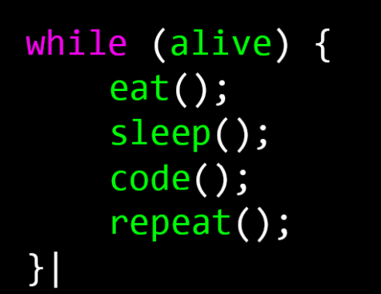

<!-- ## Hello There 👋☕ ## -->

<h1 align="center">
  <a href="https://git.io/typing-svg"></a>
    </h1>
<h3 align="center">| Java Developer ☕| Python Data Analyst 🐍 |</h3>
<br>
<div align="center" style="display: block;">
    
</div>

<br>

```yaml
👤 Name: Felipe Zanluca;
📚 Schooling: Degree in Systems Analysis and Development (Equivalent to an Associate's Degree) from Uniavan University;
📍 Living: Itajaí - SC, Brazil;
🔭 I’m currently looking for Java Opportunity;
📧 Contact: felipezanluca@gmail.com.

📖 A lifelong learner, passionate about continuously seeking knowledge and improving skills.

```
<hr>
<h3 align="center" > 
📚 Languages - Frameworks - Tools - Libraries - Workspace 📚 </h3>
<p align="center">
    

<!--
- 💼 Work: Data Analyst at MBRF S.A;
- 🔭 I’m currently working on ...
- 🌱 I’m currently learning ...
- 👯 I’m looking to collaborate on ...
- 🤔 I’m looking for help with ...
- 💬 Ask me about ...
- 📫 How to reach me:...
- 😄 Pronouns: ...
- ⚡ Fun fact: ...
-->

